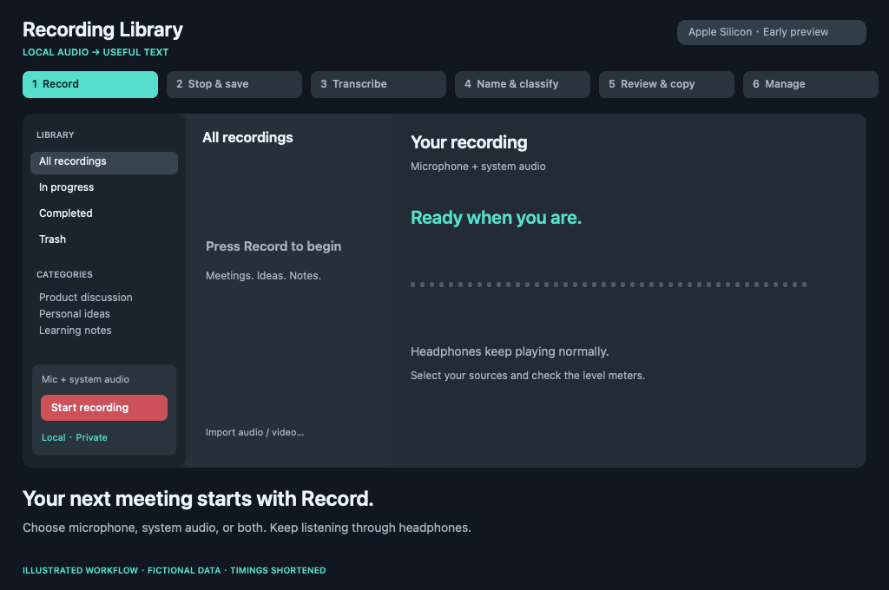

# Recording Library — Apple Silicon early preview

本機錄音與逐字稿資料庫：**按下錄音 → 停止儲存 → 本機轉錄 → 自動命名分類 → 閱讀／搜尋／複製 → 管理**。

主要從錄音按鈕開始，適合戴耳機開會、記錄個人想法或學習內容；也支援匯入既有音訊／影片。

這是使用虛構資料的示意動畫，等待時間經過縮短，不是實際螢幕錄影、辨識品質或速度測試。[使用虛構範例試用](../Examples/README.md)。

App 操作介面支援英文及繁體中文，依 macOS 偏好語言顯示，也能在系統設定指定 App 語言。介面語言與轉錄語言分開；既有逐字稿與標題不會被翻譯。目前 Qwen 命名仍使用繁體中文提示，保留英文術語。

支援麥克風、系統聲音或兩者一起錄；雙來源指定 Mac 內建麥克風，耳機維持播放。支援 M4A 與影片音軌、即時文字預覽、中文子字串搜尋、原稿與編輯版來源鏈、重複檔辨識、垃圾桶與復原。

可選擇本地 WhisperKit Core ML 模型及 MLX 文字模型，推薦 Whisper large-v3＋Qwen3-1.7B-4bit。Qwen 只產生標題／分類，不修改逐字稿。可關閉自動命名分類，只使用 Whisper。

## 安裝

先安裝 Apple Command Line Tools 與 Homebrew，再依根目錄 README 執行 `brew install uv ffmpeg`、`Scripts/setup-models.sh`、`Scripts/build.sh`、`Scripts/install.sh`。

App 安裝到 `~/Applications/Recording Library.app`；資料、模型及 runtime 保存在 `~/Library/Application Support/RecordingLibrary/`。設定中可選既有模型位置。既有相容 MacWhisper 模型會原地沿用，不搬動或複製。

這是開源預覽版，目前為本機 ad-hoc 簽章，尚非已公證的免設定下載版本。模型／套件準備需要網路，正常轉錄與命名程序禁止網路。

## 注意

- 先試錄確認兩個音量條都有訊號；系統聲音會包含其他 App 與通知音。
- 裝置或格式切換時停止並保留已寫入部分；不會自動切換錄音裝置。
- 關閉視窗繼續錄音；⌘Q 嘗試先儲存。中斷檔案保留在待處理錄音。
- 移到垃圾桶可復原；永久刪除只清理 Library 管理的檔案。原始外部來源與模型不受影響。
- 搜尋不是語意搜尋；中英混用及工程術語仍可能辨識錯誤。
- 尚無自動保留期限、iCloud、說話者分離、逐字稿優化或 AI 摘要。
- 時間與日期依系統時區顯示。

公開 repo 只有程式碼與合成測試，不包含任何使用者錄音、逐字稿、資料庫或模型權重。回報問題請用可公開的合成素材，避免上傳會議內容。
