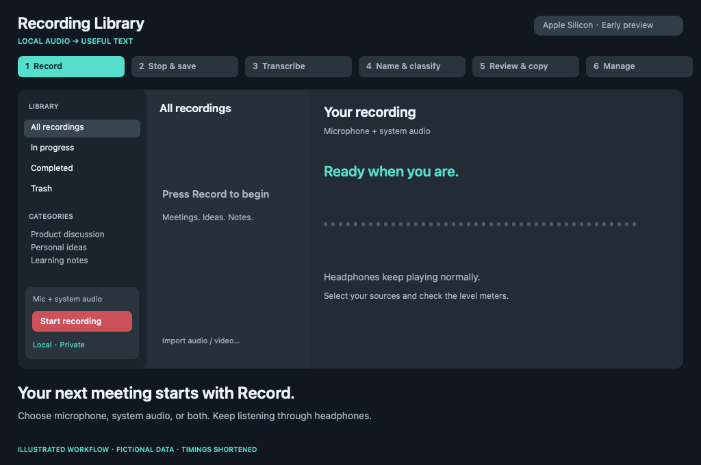

# Recording Library

A local recording and transcript library for Apple Silicon Macs. Record a meeting or import audio/video, transcribe on your Mac, review the original, and take the text into the tools you already use.

**Early preview — macOS 14.2+, Apple Silicon.** English and Traditional Chinese controls follow your macOS language preference. Source builds and manual dependency setup are supported; this is not yet a notarized, zero-setup consumer download.

## Workflow

**Press Record → Stop & save → Transcribe locally → Name & classify → Review / Search / Copy → Manage**



*Actual app views with step-by-step captions and fictional data. Recording/inference states are replayed and waits shortened; this is not a live recording or model benchmark.*

Start a headphone meeting recording, capture a personal voice note, or save a learning session. When you stop, local Whisper produces the transcript; optional Qwen suggests a dated title and category. Return later to search, check the audio, and copy useful text into your own tools. Existing audio/video can also be imported.

[Try fictional examples without recording a real conversation](Examples/README.md).

- Microphone, system audio, or both. In dual-source mode the Mac's built-in microphone is selected; headphones keep playing normally.
- M4A and other common audio formats; MP4 and other video audio tracks via FFmpeg.
- Local WhisperKit/Core ML transcription with incremental text preview, language hints, failure/cancellation and retry.
- Original raw results stay separate from linked edit revisions. Timestamp diagnostics report blank, backward and out-of-bounds segments without rewriting evidence.
- Chinese substring search, audio playback, Markdown export, dates, categories and duplicate detection.
- Optional local Qwen naming/category suggestions. This does **not** rewrite transcripts, summarize meetings or identify speakers.
- App trash with restore; permanent cleanup requires confirmation. External source files and model files are not deleted.

No account, cloud transcription API or hosted backend is required. Model/package setup needs the Internet. Normal transcription and naming subprocesses are network-denied using macOS `sandbox-exec`. Copying text into ChatGPT or another online tool is your separate choice.

## Build and run

Install [Apple Command Line Tools](https://developer.apple.com/xcode/resources/) and [Homebrew](https://brew.sh/) first. Swift 6.1.2 was used for the original M4 build; the SwiftPM manifest requires tools 5.10+.

```bash
brew install uv ffmpeg
git clone https://github.com/TSUNGYENTSAI/recording-library.git
cd recording-library
./Scripts/setup-models.sh
./Scripts/build.sh
./Scripts/install.sh
open "$HOME/Applications/Recording Library.app"
```

`build.sh` builds the pinned WhisperKit helper from source. It does not depend on an existing precompiled helper or a MacWhisper installation. Build output is `dist/Recording Library.app`; generated files are ignored by Git. Builds use an ad-hoc local signature. See [distribution notes](Docs/DISTRIBUTION.md) before distributing downloaded binaries to other users.

`install.sh` installs to `~/Applications/Recording Library.app` and refuses to overwrite an existing bundle. Quit the app and move the previous bundle aside before updating. Your Library and models remain outside the app bundle.

## Languages

App controls support **English and Traditional Chinese**, following your macOS preferred language (or the per-app language in System Settings). This is separate from the recording/transcription language hint. Changing the interface language does not translate your transcripts or existing titles. Qwen's current naming prompt produces Traditional Chinese titles and retains technical terms; English title generation is not yet included. Category labels are translated for display while their stored IDs remain unchanged.

## Models and setup

Open **Recording Library → Settings** to choose directories or prepare the recommended models. Settings show missing dependencies rather than downloading automatically on launch.

| Task | Recommended default | Format |
| --- | --- | --- |
| Transcription | Whisper large-v3 (`openai_whisper-large-v3-v20240930`) | WhisperKit Core ML |
| Title/category | Qwen3-1.7B-4bit | MLX |

The recommended downloads are pinned in [`Scripts/models.lock.json`](Scripts/models.lock.json). Setup checks published SHA-256 hashes for downloaded LFS files, including weights. Allow at least 6 GB of free space for models, runtime and download/build overhead. Swift/Core ML compilation can need additional space.

- Use **existing model directories** to avoid duplicate downloads. A compatible existing MacWhisper model/tokenizer pair is discovered and reused in place; it is never moved or removed.
- Users without MacWhisper download from the original public model repositories.
- Turn off **automatic naming and classification** to use Whisper alone. A successful transcription is then complete without a Qwen job.
- `./Scripts/setup-models.sh "$HOME/Library/Application Support/RecordingLibrary" --no-text-model` skips Qwen weights. The setup runtime is still used by the downloader.
- Setup retries preserve an existing `model-settings.json`. Select newly downloaded paths in Settings if you previously chose another location.
- Other compatible Core ML/MLX directories can be selected, but other model sizes/architectures are not yet validated. GGUF and arbitrary model formats are not supported by these backends.
- You can manually retry naming even when automatic naming is off, provided the text model/runtime are configured.

## Recording

Start from the sidebar or press **Shift-Command-R**. macOS asks for microphone and/or system audio permission when appropriate. Dual recording uses a private Core Audio aggregate and an unmuted process tap; it does not change your default input/output, volume or mute.

Each input retains its PCM format; the mixer detects whether HAL delivers frames at the advertised stream rate or the shared aggregate clock, including the 48 kHz built-in mic + 24 kHz Bluetooth-call configuration. Bounded queues align sources before writing one 16 kHz mono PCM CAF. Timing disagreement triggers audited resampling or silence padding and a nonfatal notice, so it does not end the recording. Dual sources use 0.5 gain each; single-source recording keeps unity gain. Source levels are displayed separately.

Pausing resumes the same recording. Stopping archives in place and queues transcription. No extra full recording copy is kept. Closing the window continues recording; Command-Q stops and attempts to save before quitting. Interrupted or unarchived files remain under pending recordings. Device/format changes stop recording and retain the written portion; automatic device switching is not implemented.

System capture includes all app playback and notifications. If no system signal is detected, the recording stays pending for review instead of being silently treated as a successful dual recording. Headphone/call-device behavior varies: test a short recording on your setup first. Capturing only one selected app is not implemented.

## Data and privacy

Default storage: `~/Library/Application Support/RecordingLibrary/`.

- `library.sqlite`: local index and metadata.
- `recordings/<UUID>/`: one owned media file, original results, linked edits and diagnostics.
- `Models/` and `Runtime/`: selected/downloaded local dependencies.
- `model-settings.json`: user-selected paths and automatic naming preference.

All these are outside the repository. The repository contains **no real recordings, transcripts, user databases, credentials or model weights**. Tests use deterministic synthetic text/audio, never a contributor's meeting recording. Do not attach confidential transcripts to GitHub issues.

Search is Unicode-aware substring matching, not semantic search or a Chinese-language accuracy guarantee. No automatic retention expiry, cloud sync, diarization or transcript enhancement is included. Back up the entire Library folder while the app is closed if you need a complete copy of recordings and revision history.

## Tests

```bash
./Scripts/test.sh
```

Tests exercise storage/revision preservation, Chinese search, trash/restore, model settings and mixed PCM formats without starting microphone/system capture or downloading model weights. Optional local end-to-end tests are documented in [validation](Docs/VALIDATION.md). CI builds on an Apple Silicon runner.

## Status and contributions

This project grew from a personal workflow on an M4 / 16 GB Mac. Several days of use are useful feedback, not a general reliability guarantee. See [known limitations](Docs/VALIDATION.md). Small bug reports with OS/chip/audio-device information and synthetic reproductions are welcome.

MIT licensed application code. See [third-party notices](THIRD_PARTY_NOTICES.md) for dependency/model licenses. Models and external FFmpeg installations retain their own licenses.

[繁體中文使用說明](Docs/README.zh-TW.md)
